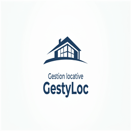

# GestyLoc

  

**GestyLoc** est un logiciel de bureau (Windows) de gestion locative pour
propriétaires privés : suivez vos biens, vos locataires, vos loyers et vos
quittances — sans abonnement, sans internet, sans quitter votre PC.

> 💡 Pensé pour les petits propriétaires (quelques appartements et garages)
> qui veulent une solution **simple, locale et gratuite**, sans compte ni
> synchronisation cloud.

## ✨ Ce que GestyLoc sait faire

- **Biens & locataires** : fiche complète pour chaque bien (type, surface,
  meublé…) et chaque locataire (coordonnées), reliés par un contrat de bail
- **Loyers & IRL** : loyers HC/CC, loyer au m², loyer annuel, frais d'agence —
  avec un outil de **révision annuelle guidée** qui calcule le nouveau loyer à
  partir de l'IRL au centime près
- **Quittances** : génération de quittances conformes (article 21, loi de
  1989) en **PDF** ou **impression directe** — à l'unité ou **toutes d'un
  coup** pour un mois donné
- **Suivi des paiements** : pointez chaque loyer comme payé, partiel, en
  retard ou impayé
- **Alertes automatiques** : fins de bail qui approchent (< 90 jours),
  révisions IRL à effectuer, loyers impayés
- **Statistiques** : encaissements des 12 derniers mois, répartition par type
  de bien, loyer moyen au m²
- **Documents** : joignez baux, états des lieux et assurances à chaque bail
- **Vos données vous appartiennent** : tout est stocké localement sur votre
  ordinateur (SQLite), aucune donnée ne quitte votre machine

## 📥 Installation

1. Rendez-vous sur la page [Releases](https://github.com/galaxiel/GestyLoc/releases/latest)
2. Téléchargez **`gestyloc-x.y.z-setup.exe`**
3. Lancez-le : l'installation prend quelques secondes

**Quel fichier télécharger ?** Une release contient 5 fichiers — un seul t'intéresse
généralement :

| Fichier | Pour qui |
|---|---|
| `gestyloc-x.y.z-setup.exe` | 👤 **Toi** — l'installateur classique (recommandé) |
| `GestyLoc-x.y.z-portable.zip` | 👤 **Toi** — version portable : extrais le dossier où tu veux (Bureau, clé USB), l'exe et tes données y vivent ensemble |
| `GestyLoc-portable.zip` | 👤 **Toi** — la version portable complète (voir ci-dessus) |
| `…setup.exe.blockmap` et `latest.yml` | ⚙️ **La machine** — utilisés automatiquement par les mises à jour, ignore-les |

Les mises à jour sont **automatiques** : le logiciel vérifie les nouvelles
versions au démarrage, vous propose de les télécharger, et installe au
redémarrage. Vous n'avez rien à faire.

**Configuration requise** : Windows 10/11 (64 bits). Aucune autre dépendance.

> **Deux formats disponibles** : l'**installateur** (`gestyloc-x.y.z-setup.exe`,
> recommandé : raccourci bureau, mises à jour automatiques) et la **version
> portable** (`GestyLoc-portable.zip` : extrais le dossier où tu veux — Bureau,
> clé USB — et toutes les données vivent dans ce dossier, à côté de l'exe).

## 🔒 Vos données

Les données sont stockées dans `%APPDATA%\gestyloc\data\app.db` sur votre PC.
Pensez à faire des **sauvegardes régulières** : Paramètres → Données →
« Sauvegarder la base » (fichier à conserver précieusement, restorable en un
clic). Un export CSV est également disponible si vous voulez réutiliser vos
données dans Excel.

## 🛠️ Pour les développeurs

GestyLoc est construit avec Electron, React, TypeScript et SQLite
(better-sqlite3 + Drizzle ORM). Le projet est **100 % local et open source** :

- `CONTRIBUTING.md` : installer l'environnement, comprendre l'architecture,
  publier une version
- `ROADMAP.md` : ce qui est fait et ce qui est prévu
- `AGENTS.md` : note de passation technique (pour développeurs et agents LLM)

## ☕ Soutenir le projet

GestyLoc est gratuit et open source. Si tu l'utilises et qu'il te fait gagner
du temps, un café fait toujours plaisir :
[Buy Me a Coffee](https://buymeacoffee.com/gestyloc)

## 📄 Licence

[MIT](LICENSE) — utilisez, modifiez et redistribuez librement.
